# Architecture SATIL

## 1. Architecture fonctionnelle

| Module | Rôle | État |
| --- | --- | --- |
| 0. Référentiel | Pays, régions, villes, ports, catégories, codes HS, produits | **V1** |
| 1. Market Intelligence | Indicateurs, prix, enquêtes, concurrents, flux, sources, comparateur de pays | **V1** |
| 2. Sourcing Chine | Fournisseurs, pipeline, devis, comparaison de devis | **V1** (catalogues et photos : V2) |
| 3. Simulateur de rentabilité | Coût rendu, marges, seuil, scénarios, LCL/FCL, BFR | **V1** (consolidation hub/pays/groupe : V2) |
| 4. Business plan | Faisabilité par hub, prévisions, VAN/TRI, stress tests, dossier investisseur | V2 (formules VAN/TRI déjà testées) |
| 5. Logistique et entrepôts | Conteneurs, expéditions, lots, mouvements, alertes, transferts | V3 (tables créées) |
| 6. CRM et marketplace B2B | Clients, devis, commandes, paiements, portails | V4 (tables créées) |
| 7. Assistant IA | Recherche sourcée, analyses, anomalies, confirmation humaine | V5 |

Principes transverses, appliqués dès la V1 :

1. **Aucune donnée inventée.** Une valeur absente s'affiche « non disponible ». Une estimation interne porte le statut
   « hypothèse ». Les exemples sont marqués **DEMO** dans chaque liste, graphique, export et simulation qui les utilise.
2. **Toute donnée de marché est sourcée** : source, URL, date de collecte, période de référence, unité, devise, méthode,
   niveau de confiance, statut de vérification. Le statut « vérifié » exige une source ou une URL.
3. **Aucun pays n'est présumé meilleur.** Le comparateur ne contient aucun poids caché : critères, poids, sens et
   couverture sont visibles et modifiables.
4. **Rien d'irréversible sans humain.** Suppressions confirmées et journalisées ; l'assistant IA (V5) ne pourra ni
   acheter, ni payer, ni supprimer, ni envoyer sans confirmation.

## 2. Architecture technique

```
Navigateur (PWA)                                   Supabase
┌──────────────────────────────────────────┐      ┌─────────────────────────────────────┐
│ React 19 + TypeScript + Vite             │      │ Auth (e-mail + mot de passe, MFA)   │
│ Tailwind 4, composants type shadcn/ui    │ HTTPS│ PostgREST : API REST auto-générée   │
│ React Router, TanStack Query             │◄────►│ PostgreSQL 15+                      │
│ lib/finance.ts, lib/scoring.ts (purs)    │  clé │  • 37 tables, contraintes CHECK     │
│ lib/store.ts : SupabaseStore | LocalStore│ publ.│  • RLS : organisation, rôle, pays   │
│ ExcelJS / PapaParse (chargés à la demande)│     │  • déclencheurs d'audit             │
└──────────────────────────────────────────┘      │  • fonctions RPC SECURITY DEFINER   │
                                                   │ Edge Functions (V5 : IA, connecteurs)│
                                                   └─────────────────────────────────────┘
```

- **Deux modes de stockage, une interface** (`Store`). *Supabase* : mode normal, multi-utilisateurs, sécurisé par la
  base. *Local* : stockage du navigateur, mono-poste, pour démarrer ou travailler sans projet Supabase ; annoncé en
  permanence par un badge « Mode local ».
- **Sécurité dans la base, pas dans l'interface.** L'interface masque les boutons interdits ; ce sont les politiques RLS
  qui refusent. Seule la clé publique Supabase est présente dans le navigateur.
- **Clés d'API tierces** (IA, Comtrade…) : uniquement dans des Edge Functions, jamais dans une variable `VITE_*`.
- **CRUD déclaratif** : une ressource = une entrée dans `src/resources/index.ts`. La page générique en déduit liste,
  recherche, formulaire, validation, import, export, historique. Ajouter une table en CRUD ≈ 10 lignes.
- **Calculs purs et testés**, indépendants de l'interface et de la base.
- **PWA** : manifeste + service worker qui met en cache l'interface uniquement ; les données ne sont jamais servies
  depuis un cache.
- **i18n** : dictionnaire unique FR/EN/ZH ; un test échoue si une clé manque dans une langue.

## 3. Rôles et droits

| Rôle | Lecture | Écriture | Suppression | Journal |
| --- | --- | --- | --- | --- |
| Super administrateur | tout | tout, membres | oui | oui |
| Associé investisseur | tout | — | — | oui |
| Directeur pays | ses pays | tous domaines sauf paiements | oui (ses pays) | oui |
| Analyste | tout | référentiel, marché, finance, risques | — | — |
| Acheteur | tout | sourcing, fret | — | — |
| Logisticien | tout | logistique, fret | — | — |
| Comptable | tout | finance, paiements | — | oui |
| Commercial | tout | marché (prix, enquêtes), CRM | — | — |
| Client grossiste / Fournisseur | **rien** (portails en V4) | — | — | — |

« Ses pays » : `memberships.country_ids` ; `null` = tous les pays. La matrice est la fonction SQL `can_write`
(`0002_security.sql`), reflétée dans `src/lib/permissions.ts`.

## 4. Schéma de base de données

Toutes les tables métier portent `id uuid`, `org_id → organizations`, `is_demo`, `created_at`, `updated_at`,
`created_by`. Les tables marquées ★ portent les colonnes de provenance : `source_id → data_sources`, `source_url`,
`collected_at`, `reference_period`, `unit`, `currency`, `method`, `confidence`, `verification_status`.

```mermaid
erDiagram
  organizations ||--o{ memberships : "a pour membres"
  users ||--o{ memberships : "appartient à"
  organizations ||--o{ audit_logs : journalise
  countries ||--o{ regions : contient
  countries ||--o{ cities : contient
  regions ||--o{ cities : regroupe
  countries ||--o{ ports : dispose
  countries ||--o{ hubs : accueille
  hubs ||--o{ warehouses : exploite
  product_categories ||--o{ products : classe
  hs_codes ||--o{ products : qualifie
  suppliers ||--o{ supplier_quotes : émet
  products ||--o{ supplier_quotes : concerne
  data_sources ||--o{ market_indicators : source
  countries ||--o{ market_indicators : décrit
  countries ||--o{ field_surveys : localise
  countries ||--o{ competitors : localise
  countries ||--o{ price_observations : localise
  products ||--o{ price_observations : concerne
  countries ||--o{ trade_flows : déclare
  hs_codes ||--o{ trade_flows : classe
  countries ||--o{ customs_rules : applique
  hs_codes ||--o{ customs_rules : vise
  ports ||--o{ freight_quotes : destination
  products ||--o{ financial_scenarios : simule
  countries ||--o{ financial_scenarios : cible
  hubs ||--o{ investments : nécessite
  hubs ||--o{ operating_costs : supporte
  suppliers ||--o{ shipments : expédie
  shipments ||--o{ containers : comprend
  warehouses ||--o{ inventory_lots : stocke
  products ||--o{ inventory_lots : concerne
  inventory_lots ||--o{ stock_movements : trace
  customers ||--o{ leads : origine
  customers ||--o{ quotations : reçoit
  customers ||--o{ orders : passe
  quotations ||--o{ orders : devient
  orders ||--o{ payments : règle
  countries ||--o{ risk_register : expose
```



| Domaine | Tables |
| --- | --- |
| Accès | `organizations`, `users`, `memberships`, `audit_logs` |
| Géographie | `countries`, `regions`, `cities`, `ports`, `hubs`, `warehouses` |
| Produits | `product_categories`, `hs_codes`, `products` |
| Sourcing | `suppliers`, `supplier_quotes` |
| Marché | `data_sources`, `market_indicators`★, `field_surveys`★, `competitors`★, `price_observations`★, `trade_flows`★, `customs_rules`★ |
| Coûts | `freight_quotes`★, `exchange_rates`★ |
| Finance | `financial_scenarios`, `investments`, `operating_costs` |
| Logistique | `shipments`, `containers`, `inventory_lots`, `stock_movements` |
| Ventes | `customers`, `leads`, `quotations`, `orders`, `payments` |
| Risques | `risk_register` |

Choix notables :

- `users` est le profil public lié à `auth.users` (créé par déclencheur) ; aucun mot de passe n'y figure.
- `exchange_rates` s'ajoute à la liste demandée : les taux doivent être datés et sourcés comme toute donnée.
  Seule la parité fixe EUR/XOF (655,957) est fournie d'office ; les autres taux sont à saisir.
- `financial_scenarios.inputs` / `results` (jsonb) conservent les hypothèses et le résultat **tels qu'au moment de
  l'enregistrement**, pour qu'une simulation reste relisible même si les données de base changent.
- Historisation : `audit_logs` garde l'ancienne et la nouvelle valeur de chaque ligne ; l'écran « Historique » les relit.
- Délais de livraison (objectif 7–10 jours depuis stock local) : aucun délai n'est codé en dur ; ils seront **mesurés**
  à partir de `shipments` et `orders` en V3/V4.

## 5. Maquettes

L'application elle-même tient lieu de maquette : `docs/captures/` contient les écrans réels, bureau (1440 px) et mobile
(iPhone 13), produits par le test de bout en bout avec le jeu DEMO.

Identité visuelle : bleu nuit (structure, en-têtes de tableaux), vert émeraude (actions, données vérifiées), or (lignes
clés : coût de revient unitaire, meilleur devis, premier du classement), bleu ciel (trésorerie : TVA récupérable, BFR),
rouge (alertes, résultat négatif), violet (DEMO).
